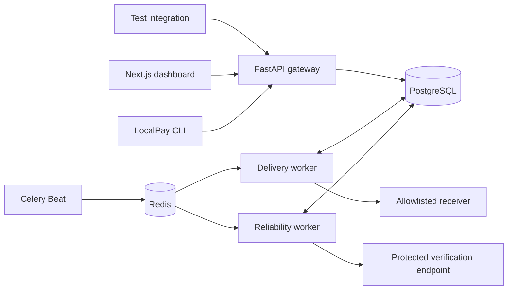

# Architecture

LocalPay is a modular monolith. FastAPI routes adapt HTTP contracts to transaction-oriented services in `apps/api/app/services`. The Razorpay binding lives at the API boundary. Payment and refund services own their state transitions and use integer minor units.

Project API credentials establish a tenant before any gateway query. Composite foreign keys prevent links between projects. The administration API uses a separate bearer credential. Browser sessions use an HttpOnly signed cookie through a Next.js proxy. The API Workspace and Payment Simulator use a separate gateway route that checks the supplied Basic credentials against the selected project and forwards only supported routes to the configured LocalPay upstream. [API Workspace](api-workspace.md)

Capture locks the payment and order before recording balances. Refund operations lock the payment and include pending reservations in the available balance. The foreign keys and amount constraints add safeguards beneath the service layer.

Event bytes and scheduled delivery records are committed in the same database transaction as the state they describe. Redis transports Celery tasks. PostgreSQL remains the durable schedule. Delivery leases and attempt identities allow recovery after interruptions. Delivery is at least once.

The reliability worker runs a separate queue so webhook delivery can proceed while a suite waits for observations. Reports combine assertion evidence, recorded state transitions, and delivery attempts. Additional providers can add their own protocol routes and serialization against the shared service boundaries.
